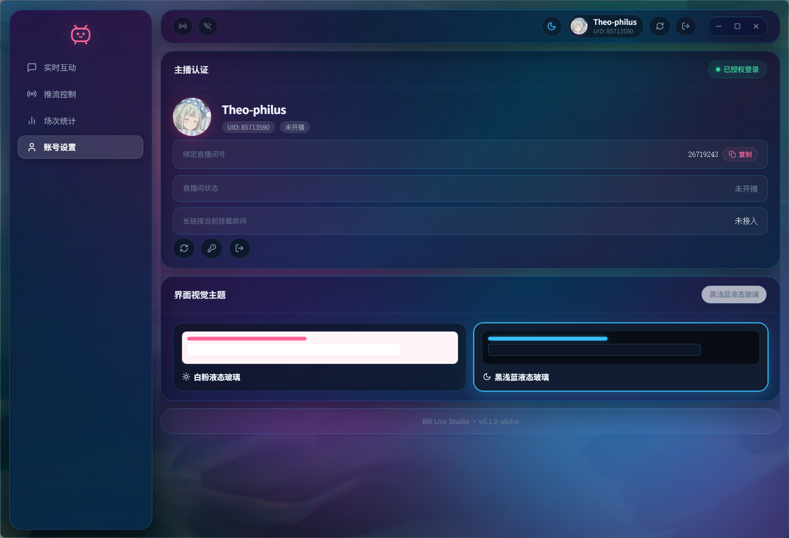
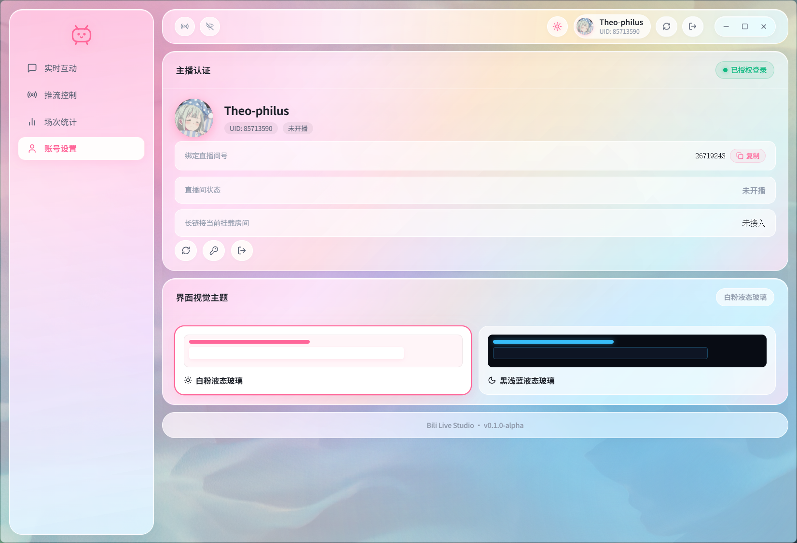

<div align="center">

  

  # Bili Live

  **A modern, lightweight live streaming and interaction console for Bilibili.**

  <p align="center">
    <a href="#features">Features</a> &nbsp;•&nbsp;
    <a href="#quick-start">Quick Start</a> &nbsp;•&nbsp;
    <a href="#build">Build</a> &nbsp;•&nbsp;
    <a href="#security">Security</a> &nbsp;•&nbsp;
    <a href="README.zh-CN.md">简体中文</a>
  </p>

  <p align="center">
    
    
    
    
  </p>

  <p align="center">
    English &nbsp;|&nbsp; <a href="README.zh-CN.md">简体中文</a>
  </p>

</div>

> A clean, native desktop companion for Bilibili streamers. Built for instant startup, low memory footprint, and secure credential handling.

<div align="center">
  <p align="center"><b>🌙 Dark Mode</b></p>
  
  <p align="center"><b>☀️ Light Mode</b></p>
  
</div>

---

## Features

- **QR Code Sign-in** &mdash; Fast authentication with the mobile app; credentials are encrypted by the OS credential vault (Windows DPAPI / Linux Secret Service) without plain cookies on disk.
- **Broadcast Control** &mdash; Category selection, one-click start/stop broadcasting, and protected RTMP stream keys ready for OBS.
- **Live Danmaku & Emoticons** &mdash; Real-time Danmaku with official Bilibili emoticon rendering, gift events, Super Chats, guard renewals, and viewer interactions with automatic reconnection.
- **Post-Stream Summary** &mdash; Instant overview of duration, total views, peak viewers, danmaku counts, and fan trends upon ending a stream.
- **Dual-Mode Workflow** &mdash; Run natively as a desktop app or launch in any browser for full-featured debugging.

---

## Quick Start

### 1. Browser Simulation Mode

Run a complete development session in your browser with live Rust backend services:

```powershell
npm run web
```

### 2. Desktop Client Mode

Run the native desktop application with live reload:

```powershell
npm run tauri dev
```

---

## Build

Package the application for production distribution.

### Windows

```powershell
# Build NSIS installer and release binaries
npm run tauri build

# Build standalone executable only
npm run tauri build -- --no-bundle
```

Installer output directory: `src-tauri/target/release/bundle/nsis/`

### Linux (Debian / Ubuntu)

Install system dependencies first:

```bash
sudo apt update
sudo apt install -y libwebkit2gtk-4.1-dev libgtk-3-dev libsoup-3.0-dev \
  libjavascriptcoregtk-4.1-dev librsvg2-dev libayatana-appindicator3-dev \
  build-essential pkg-config
```

Then build:

```bash
npm install
npm run tauri build
```

Output directories:

- `src-tauri/target/release/bundle/appimage/*.AppImage` (portable single file)
- `src-tauri/target/release/bundle/deb/*.deb` (Debian / Ubuntu package)

---

## Linux Notes

### Option 1: AppImage (recommended, no installation)

```bash
chmod +x Bili.Live_*.AppImage
./Bili.Live_*.AppImage
```

If FUSE is missing: `sudo apt install libfuse2`, or run with `--appimage-extract-and-run`.

### Option 2: deb package

```bash
sudo apt install ./Bili.Live_*.deb
```

### Platform differences

- **Credential storage**: uses the system Secret Service (GNOME Keyring / KWallet). Without an available keyring the session cannot be persisted and you will need to scan the QR code again on each launch.
- **Pinned overlay click-through**: identical to Windows on X11 sessions (move the cursor over the pin button to unlock). On Wayland the global cursor position cannot be read for security reasons, so the overlay stays fully click-through — close or reopen it from the main window to release.
- **Auto-update**: running as AppImage supports in-place replacement and automatic restart; deb packages are handed to the system software center.

---

## Security

- Session cookies are strictly maintained in the OS credential vault (Windows DPAPI / Linux Secret Service) and never exposed to the frontend.
- Stream keys remain masked by default until explicitly copied or toggled.
- Active broadcasts cannot be exited accidentally without explicit confirmation.

---

## Disclaimer

This is an unofficial community project not affiliated with or endorsed by Bilibili. Please comply with platform rules and use within authorized broadcasting permissions.

Licensed under the [MIT License](LICENSE).
