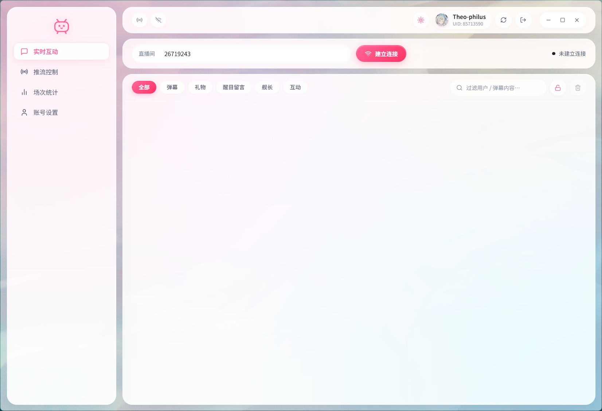

<div align="center">

  

  # Bili Live 桌面控制台

  **现代、轻量、高颜值的 B 站直播辅助与实时弹幕互动控制台**

  <p align="center">
    <a href="#核心特性">核心特性</a> &nbsp;•&nbsp;
    <a href="#快速启动">快速启动</a> &nbsp;•&nbsp;
    <a href="#项目构建">项目构建</a> &nbsp;•&nbsp;
    <a href="#安全机制">安全机制</a> &nbsp;•&nbsp;
    <a href="README.md">English</a>
  </p>

  <p align="center">
    
    
    
  </p>

  <p align="center">
    <a href="README.md">English</a> &nbsp;|&nbsp; 简体中文
  </p>

</div>

> 为 B 站主播打造的原生桌面中控台。专注极简启动、超低内存开销与凭据安全管理。

<div align="center">
  
</div>

---

## 核心特性

- **快捷扫码登录** &mdash; 手机客户端一键扫码，凭据经 Windows 凭据管理器硬件级加密，磁盘不落明文 Cookie。
- **直播推流中控** &mdash; 动态分区选择、一键开播与下播防误触，推流地址与密钥默认打码并支持一键复制到 OBS。
- **实时弹幕互动** &mdash; 毫秒级接入普通弹幕、礼物、醒目留言（SC）、大航海舰长及互动通知，断网自动平滑重连。
- **下播数据复盘** &mdash; 终止直播后自动呈现真实直播时长、总观看、峰值在线、弹幕总数与金仓鼠流水明细。
- **创新双模运行** &mdash; 既可作为极低资源占用的原生桌面客户端，也支持在任意现代浏览器中开启全功能开发调试。

---

## 快速启动

### 1. 浏览器全功能调试模式

无需原生编译，直接在浏览器中联动后端真实服务进行全流程调试：

```powershell
npm run web
```

### 2. 桌面客户端开发模式

启动带有热重载的原生桌面窗口：

```powershell
npm run tauri dev
```

---

## 项目构建

构建面向正式发布的安装包与可执行程序：

```powershell
# 构建 NSIS 安装向导包与发布程序
npm run tauri build

# 仅构建独立可执行文件（免安装包）
npm run tauri build -- --no-bundle
```

安装程序输出路径：`src-tauri/target/release/bundle/nsis/`

---

## 安全机制

- 登录凭据全流程由系统底层（DPAPI）加密托管，前端不接触原始 Cookie。
- 串流密钥等敏感信息默认打码隐藏，仅在主动点击或复制时解密。
- 直播进行期间限制直接注销或切换账号，防止丢失下播控制权。

---

## 免责声明

本项目为第三方开源项目，非哔哩哔哩官方产品。请自觉遵守平台服务规范，仅操作具有合法管理权限的直播间。

基于 [MIT 许可证](LICENSE) 开源。
